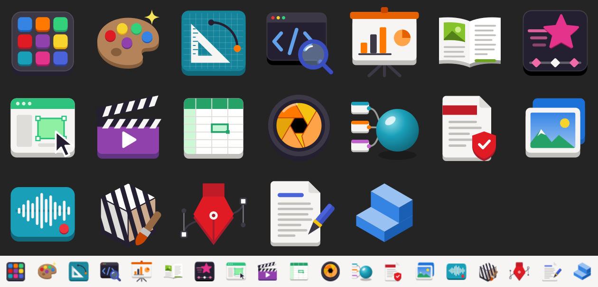

# Craft Adwaita Icons

Adwaita-style app icons for the [Craft App Suite](https://getartcraft.com/apps): ArtCraft Launcher,
ArtCraft, PhotoCraft, VectorCraft, FilmCraft, LightCraft, PdfCraft, EffectCraft, DesignCraft,
FigCraft, WordCraft, SoundCraft, DeckCraft, GridCraft, CADCraft, TextureCraft, MaterialCraft,
Craft Anything and SolidCraft.



An unofficial theme, not affiliated with Learning Machines LLC or Tangency Labs. Each icon uses the
app's own icon name, so installing it replaces that app's packaged icon.

## Install

```bash
./install.sh
```

This installs into `~/.local/share/icons/hicolor` as SVGs plus PNGs at every fixed size, because
GTK prefers a packaged exact-size PNG over a scalable SVG. Remove them with `./install.sh --uninstall`.
Rendering the PNGs needs Inkscape.

## Editing

The icons are drawn in code in `make_icons.py`, using the GNOME palette on a 128px grid. Run
`./make_icons.py` to regenerate `icons/scalable/apps`.

The ArtCraft icon is named `ai.storyteller.artcraft`. If your ArtCraft desktop file uses a different
`Icon=`, rename that SVG to match.

Copyright © 2026 SolarFlare Developments
